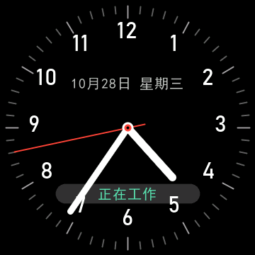
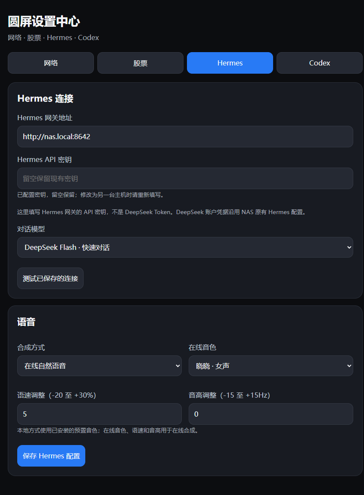

# RoundClock Desktop

**v1.0 正式版**

基于 ESP32-S3 N16R8 的 360×360 圆屏桌面终端：模拟时钟、Hermes 语音、Codex 状态和股票自选清单。
首个正式版本，基于已完成实机验证的功能发布。仓库只保存源码和配置示例，不含已烧录固件、账户凭据和设备备份。

## 界面截图

以下为实机帧缓冲截图，网页截图使用演示配置。






## 目前功能

- 模拟时钟：红秒针、日期星期、NTP 校时；横向动画应用菜单。
- Hermes：触摸启动语音，NAS 流式识别，经 Hermes 调用 DeepSeek，晓晓女声回答，文字自动滚动。
- Codex：5 小时和每周已用额度、重置时间、状态小机器人；时钟持续显示工作/等待状态，完成后语音提醒。
- 股票：代码、名称或拼音搜索自选；名称/代码/当前价格清单，超过5行可滑动与拖滚动条。支持沪深北，显示行情时间与休市状态。
- 手机配网：扫描 2.4GHz Wi-Fi；设备设置热点默认免密码。

## 设置与菜单

- 灰色圆角齿轮设置图标，时钟与设置始终保留。
- 设置采用分层页面、大号时分选择与加减按钮；开关只响应右侧触控区，抬手确认，滑动时取消操作。
- 左右滑动切换应用，当前位置动画放大，点击中间图标进入；关闭应用后自动收拢。
- 夜间模式首次默认关闭；开启后默认22:00—次日07:00，背光降至50%，白天恢复100%。时分可分别点选并逐小时/分钟调整。
- Hermes、Codex、股票可独立启用或禁用。禁用Codex后隐藏时钟状态提示并停止产生完成语音提醒。
- 设置保存在独立NVS命名空间，重启保留，不改动Wi-Fi配置。开始与结束相同时不调暗；未校准时间前保持正常亮度。
- 时钟Codex状态条背景80%透明，使用浅灰底并略微上移，文字保持不透明。
- 菜单采用缓存图标、定点缩放、双DMA缓冲和局部刷新，使用原板驱动的40MHz QSPI配置；UI任务独立运行在CPU1。

## 目录

| 目录 | 内容 |
| --- | --- |
| `firmware/` | ESP-IDF 5.5.4 圆屏固件及已保留许可证的显示、WebSocket 驱动 |
| `nas/` | Python 3.12 NAS 语音、Codex 中继与股票管理服务 |
| `codex-monitor/` | Windows 本机 Codex 用量/生命周期同步程序 |
| `tools/` | 字库生成与源码检查 |
| `tests/` | 独立本地 HTTP 契约检查，不使用真实股票或账户密钥 |
| `docs/` | 引脚、部署与当前验证范围 |

## 编译固件

在仓库根目录执行，先准备 ESP-IDF 5.5.4 和 Python/Pillow：

```powershell
python -m pip install Pillow
python tools/generate_fonts.py --cjk-font C:/Windows/Fonts/simhei.ttf --digit-font C:/Windows/Fonts/bahnschrift.ttf
Copy-Item firmware/main/voice_config.example.h firmware/main/voice_config.h
# 编辑 voice_config.h，填写自己的 NAS 地址和设备令牌
cd firmware
idf.py set-target esp32s3
idf.py build
idf.py -p COM8 flash
```

字体路径可改为自己持有的兼容中文/数字字体。生成的字库文件只保留本机，未入库；更换字体会改变排版，需检查显示。
本版为16MB Flash、8MB OCT PSRAM、8MB factory 分区。首次从其他分区布局升级需要配套分区表；不要擦除 NVS 以保留 Wi-Fi。
刷写前应在自己的电脑备份原固件，仓库不包含个人设备的备份。

## 部署 NAS

参考 [部署说明](docs/deployment.md)。复制 `nas/.env.example` 为 `nas/.env`，填入自己的设备令牌、管理令牌和原 Hermes 地址。
`ROUND_DEVICE_TOKEN` 必须与 `voice_config.h` 一致；原 Hermes 已启用带密钥的 API。
在 `nas/` 运行 `docker compose up -d`。初次启动需要下载 Python 依赖与语音识别模型。
默认语音走原 Hermes 的 DeepSeek provider，原 Hermes 需已有有效的 DeepSeek 配置；不会自动改动其密钥或默认模型。

统一设置入口为 `http://NAS_IP:8767/settings`，无需登录或设置码。包含网络状态、股票、Hermes 和 Codex 配置，详见[设置中心](docs/settings-center.md)。配置服务仅部署于受信任的局域网。
首次部署自选列表为空，由用户自己添加。行情是公开源的周期刷新数据，保留源时间，不保证交易所级实时性。

## Codex 电脑同步

复制 `codex-monitor/config.example.json` 为 `config.private.json`，填写 NAS 中继地址与独立写入令牌。
该令牌应写入 NAS 应用目录的 `codex-ingest.env`，格式 `CODEX_INGEST_TOKEN=...`；它与设备、管理令牌不同。
运行 `python codex-monitor/monitor.py --once` 验证，再在 Windows 执行 `codex-monitor/install-startup.ps1` 开启当前用户登录后隐藏启动。
官方 app-server 只读接口读取账户额度，本地会话事件读取任务状态；不启动推理，不上传账户凭据和聊天内容。

## 开发检查

```powershell
python -m pip install aiohttp python-dotenv
python tests/test_codex_relay.py
python tests/test_stock_mutations.py
python tests/test_settings_center.py
```

当前验证范围与待处理项见 [开发状态](docs/development-status.md)。上游驱动来源和许可证见 `firmware/THIRD_PARTY.md`。
